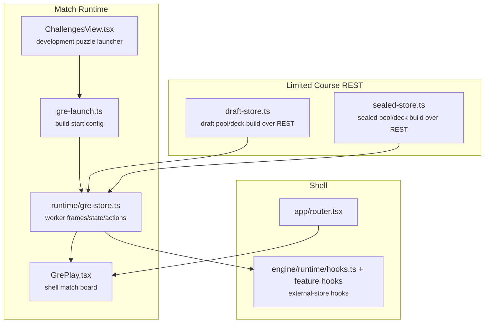

# Frontend Data Flow

All gameplay runs in a browser worker through the pinned Leyline runtime.
The product server in `server/` owns accounts, saved decks, course records,
the frozen generated puzzle pool and its ratings, roadmap votes and replay uploads. It builds without Leyline, Forge
or `browser-engine`, constructs no games, and exposes no card or gameplay routes.
Unsupported browsers show a retryable error instead of switching execution hosts.

## Ownership

| Frontend home | Owner |
| --- | --- |
| `src/features/*` | Feature UI, state stores, and feature-specific React hooks |
| `src/shared/api`, `auth`, `cards`, `ui` | HTTP contracts/client, cross-feature authentication, card utilities, and generic UI |
| `src/engine/wire`, `state`, `runtime`, `priority`, `replay` | GRE wire codec, projected state, match lifecycle, priority policy, and replay formatting |
| `src/engine/generated` | Generated GRE message descriptor |

- `server/` is the product server, TypeScript on Bun. `server/main.ts` is the entry point; releases ship
  it compiled by `bun build --compile` as one binary, embedding migrations, starter decks and
  `server/assets/card-images.sqlite`.
  - `platform/`: configuration, the product database and [schema migrations](database-migrations.md),
    HTTP routing and errors, logging, error reporting, rate limits and embedded resources.
  - `contract/`: [the HTTP contract](http-contract.md), shared with the frontend.
  - `auth/`: login email, sessions and codes (`WebAuth`), and the auth routes.
  - `replays/`: browser replay journal codec, retention index, quota and eviction, the store,
    upload admission and routes. Storage imports nothing from the HTTP layer.
  - Feature modules at the root: decks, course records, puzzles, roadmap and card images.
  - `test/`: shared test support and fixtures.
  The database remains `<resolved stateDir>/player.db`.
  The server imports nothing from Leyline; only `browser-engine/`
  builds against the Leyline composite build and launches games.
  A Leyline pin change therefore ships as a frontend release.
- `browser-engine/` is one Java 17 Gradle build. Its `forge.web.browser.cards` package owns the card presentation DTOs, Forge projection and Web decklist rules used by the browser worker and its card index build.
- The browser reads cards from the static card index in the
  browser release (`shared/cards/card-index.ts`). `browser-engine`'s
  `cardIndex` task projects every card with that package, adds Commander
  eligibility, search names and the limited set list, and the release manifest
  checks its size and SHA-256. The index identifies cards by name; its `grpId`
  values belong to one catalog build. Deck and limited HTTP requests and
  responses carry card names, never runtime identifiers, and the browser
  persists cards by name. Deck search, card display, saved-deck hydration, limited
  pools and the limited set list read it.
- Card legality runs in the session's browser engine, which the next match
  reuses. Deck import and the deck editor's save check there. Game setup does
  not check again: library decks were checked on save, pasted lists on import,
  and starter and bot decks are trusted. The engine's own start rejects a
  malformed deck through the match screen's launch failure and retry.
  `server/decks.ts` checks only a save's shape: name, format,
  positive card rows, at most 250 cards per main deck or sideboard, at most two
  commanders, a commander for Commander decks, and 200 decks per account.
  Starter decks are name lists seeded at registration.
- Deck rows are stored by exact card name in `decks.cards` as
  `{MainDeck,Sideboard,CommandZone,Companions}` lists of `{cardName,quantity}`.
  `decks.tile_name` is text. Catalog content changes alone do not invalidate
  name-based storage; a removed or renamed card fails the browser legality
  check the next time the deck is edited or launched.
- Replay viewers read card metadata embedded in the replay journal. A replay
  without it shows cards without names or text; there is no server fallback.
- `server/course-records.ts` keeps one JSON course document per
  account and event in `course_records` (`/api/course-records`). A save names
  the revision it read; a stale revision gets 409 and the browser reloads the
  record. The server checks only that the document is a JSON object, its event
  name, and size caps per document and per account; it does not read the
  contents. Migration V9 copied existing draft and sealed courses with a pool,
  and their completed draft's bot decks, into documents without a seed.
- `runtime/gre-launch.ts` builds GRE start payloads for constructed, puzzle, and saved-deck entries.
- `runtime/browser-match-recovery.ts` reuses the Browser Local seed and in-page journal after an active worker failure. `GreSession` permits one four-minute attempt for constructed and Commander games. Replay uses a fresh worker and match identity, advances saved decisions without transporting intermediate frames, and resyncs through the existing connection handshake. Engine version, recovered board, pending choice and boundary state must match before `GreStore` installs the full state and rebound prompt. The final submitted response and all later progress are undone, with an acknowledgement before input resumes. This checks decision continuity, not complete hidden engine state. Reloads and browser crashes lose the in-page journal.
- Browser match journals contain local decisions and frames. Players may upload
  them through the authenticated replay API. Existing operator replay reads remain available.
- `runtime/gre-store.ts` owns frame-source attachment, state projection, actions,
  and traffic counters. Browser workers and read-only replay sources share this fold.
  React reads it through `engine/runtime/hooks.ts`.
  Stack zone membership is top-first. The board projection preserves this order, and the stack panel marks its first visible entry as the next to resolve. When a zone row trails new ability objects, the accumulator preserves their incoming batch order above older entries until explicit membership arrives. Object refreshes retain that fallback order; deletion, stack exit and full state replacement retire it.
  Its `state/game-log.ts` fold retains at most 100 gameplay events for the board's Game log drawer. It reads transient action, transfer and damage annotations plus authoritative life totals. Card references enter history only when visible to the viewer in that frame. Full snapshots do not invent events, recovery discards events beyond a rolled-back boundary, and an explicit source reset or new match clears the history. Same-match reconnects retain it.
- `runtime/gre-dispatch.ts` owns prompt lifetime, response correlation, source
  guards, waiting, rejection, retirement, and publication. Every interactive
  family under `runtime/prompts/` owns its request, draft, constraints, projected
  instructions, and response details. Exact-view typed bindings stay outside
  serializable board snapshots. [ADR-006](adr/006-family-owned-prompt-controls.md)
  owns composition and the change scope for adding a family.
- `src/features/challenges/ChallengesView.tsx` owns the development launcher and
  resolves curated challenge identities. It passes puzzle identity, label,
  objective, and return path into `greSession`; the normal `GrePlay` board owns
  every puzzle interaction and terminal state.
- `features/decks/decks-store.ts` owns account-scoped saved-deck values, metadata loading, selection freshness, and mutation aftermath. Editors keep unsaved drafts with original card identities and all sections. The library publishes committed values and rejects old-account completions. [ADR-007](adr/007-own-complete-decks-in-the-library.md) records the ownership and presentation limits.
- `features/limited/draft-store.ts` and `features/limited/sealed-store.ts` own limited course state (pool, phase, submitted deck, match launch). They run draft and sealed commands in the browser engine and save the course as one document under `/api/course-records`.
- `shared/cards/catalog.ts` projects card index entries to DraftCards, holds the placeholder shape, and counts card names into deck rows.

## Limited-to-GRE Flow

1. Draft or sealed starts in the browser engine (`draft`, `sealed` worker commands). Each command replays the course from `{set, seed, picks, catalogVersion}` alone, so no engine state outlives a command.
2. The course document is saved under `/api/course-records/{eventName}` after every pick, the completed draft's pool and bot decks, the submitted deck, and every game result. A save names the revision it read; a 409 reloads the saved document. A reload or another browser on the same account resumes from the document.
3. A draft whose catalog version differs from the loaded worker cannot replay its picks; the player discards it and starts again. Courses copied from the old schema have no seed and open at deck building or games.
4. The deck_build phase builds a deck client-side in `LimitedDeckBuilder.tsx`. `GreSession.startBrowser` launches the course's next game locally: draft opponents take the pod's bot decks in seat order, and a sealed opponent plays a copy of the player's deck. Limited games use the constructed rules runtime while retaining draft/sealed product context.
5. A terminal local outcome adds the win or loss to the course document. The launch names the number of games already recorded, so a repeated report saves nothing. Seven wins or three losses finish the course. This solo progression trusts the browser outcome.
6. The next game is unavailable until the result is saved. A failed save stays visible with retry. Leaving before saving requires confirmation. Reload does not restore a live local game.
