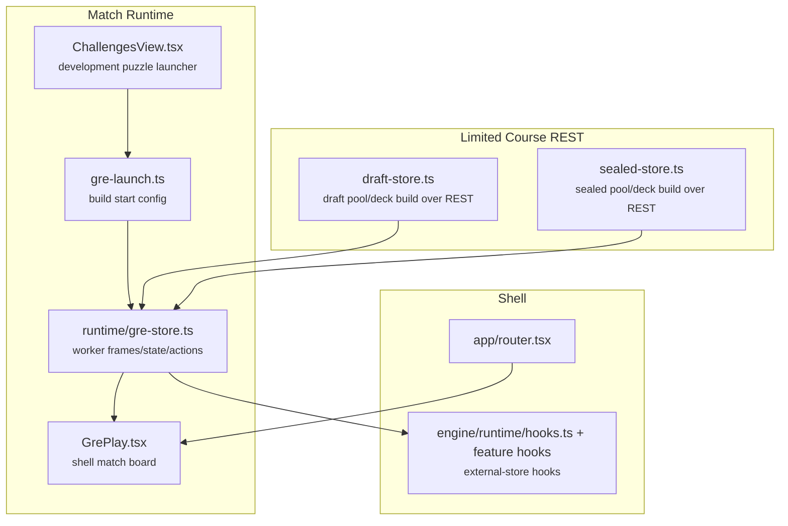

# Frontend Data Flow

All gameplay runs in a browser worker through the pinned Leyline runtime.
The product server in `server/` owns accounts, saved decks, catalog queries,
deck validation, draft generation, course progress, saved puzzles, and replay uploads.
It constructs no games and exposes no gameplay WebSocket or match-start route.
Unsupported browsers show a retryable error instead of switching execution hosts.

## Ownership

| Frontend home | Owner |
| --- | --- |
| `src/features/*` | Feature UI, state stores, and feature-specific React hooks |
| `src/shared/api`, `auth`, `cards`, `ui` | HTTP contracts/client, cross-feature authentication, card utilities, and generic UI |
| `src/engine/wire`, `state`, `runtime`, `priority`, `replay` | GRE wire codec, projected state, match lifecycle, priority policy, and replay formatting |
| `src/engine/generated` | Generated GRE message descriptor |

- `server/` owns browser-facing Ktor routes, REST DTOs, OpenAPI generation,
  process composition, product configuration, authentication, and curated challenge content. It also owns the product database
  path, connection, [schema migrations](database-migrations.md), and persistence. The database remains
  `<resolved stateDir>/player.db`; Leyline's native local storage has a separate
  lifecycle. The server consumes the pinned domain and catalog/draft services
  through the composite Gradle build. Only `browser-engine/` launches games.
- `card-presentation/` owns the Java 17 card presentation DTOs and Forge projection shared by the server and browser worker. Hosts supply artwork from their own indexes and retain their transport boundaries.
- The product server uses Leyline's Forge-backed `CardRepository` for card
  search, deck import, saved-deck hydration, and GRE metadata. Generated card
  identifiers are runtime-scoped. `SqlitePlayerStore` persists exact primary
  Forge names and resolves them to the current runtime identifiers at startup.
  It rejects removed, renamed, ambiguous, derived-face, and otherwise unknown
  identities. Deck import canonicalizes Split halves and Specialize forms to
  their parent before persistence. Ordered face links supply split-cast and Room
  door names, while GRE action costs and persistent Room designations remain the
  authority for the current action and unlocked doors. Generic left and right
  split casts are supported; fused casting is outside the current browser proof.

  Persisted card state uses the `card-name-v1` format marker in
  `product_metadata.card_storage_format`. `decks.tile_name` is text. Deck and
  course deck entries use `{cardName,quantity}`. Course pools, draft packs and
  picks, and draft pod decks are arrays of names. Collation ids and other
  non-card fields keep their existing shape; course summaries use `tileName`
  and `deckArtName`. An empty tile or art name represents the optional zero
  identity. Numeric card storage requires an explicit migration. Catalog
  content changes alone do not invalidate name-based storage, but a stored name
  removal or rename does.
- `runtime/gre-launch.ts` builds GRE start payloads for constructed, puzzle, and saved-deck entries.
- `runtime/browser-match-recovery.ts` reuses the Browser Local seed and in-page journal after an active worker failure. `GreSession` permits one four-minute attempt for constructed and Commander games. Replay uses a fresh worker and match identity, advances saved decisions without transporting intermediate frames, and resyncs through the existing connection handshake. Engine version, recovered board, pending choice and boundary state must match before `GreStore` installs the full state and rebound prompt. The final submitted response and all later progress are undone, with an acknowledgement before input resumes. This checks decision continuity, not complete hidden engine state. Reloads and browser crashes lose the in-page journal.
- Browser match journals contain local decisions and frames. Players may upload
  them through the authenticated replay API. Existing operator replay reads remain available.
- `runtime/gre-store.ts` owns frame-source attachment, state projection, actions,
  and traffic counters. Browser workers and read-only replay sources share this fold.
  React reads it through `engine/runtime/hooks.ts`.
  Stack zone membership is top-first. The board projection preserves this order, and the stack panel marks its first visible entry as the next to resolve. When a zone row trails new ability objects, the accumulator preserves their incoming batch order above older entries until explicit membership arrives. Object refreshes retain that fallback order; deletion, stack exit and full state replacement retire it.
  Its `state/game-log.ts` fold retains at most 100 gameplay events for the board's Game log drawer. It reads transient action, transfer and damage annotations plus authoritative life totals. Card references enter history only when visible to the viewer in that frame. Full snapshots do not invent events, recovery discards events beyond a rolled-back boundary, and an explicit source reset or new match clears the history. Same-match reconnects retain it.
- `runtime/gre-dispatch.ts` owns prompt lifetime, response correlation, source
  guards, waiting, rejection, retirement, and publication. Every interactive
  family under `runtime/prompts/` owns its request, draft, constraints, projected
  instructions, and response details. Exact-view typed bindings stay outside
  serializable board snapshots. [ADR-006](adr/006-family-owned-prompt-controls.md)
  owns composition and the change scope for adding a family.
- `src/features/challenges/ChallengesView.tsx` owns the development launcher and
  resolves curated challenge identities. It passes puzzle identity, label,
  objective, and return path into `greSession`; the normal `GrePlay` board owns
  every puzzle interaction and terminal state.
- `features/decks/decks-store.ts` owns account-scoped saved-deck values, metadata loading, selection freshness, and mutation aftermath. Editors keep unsaved drafts with original card identities and all sections. The library publishes committed values and rejects old-account completions. [ADR-007](adr/007-own-complete-decks-in-the-library.md) records the ownership and presentation limits.
- `features/limited/draft-store.ts` and `features/limited/sealed-store.ts` own limited course state (pool, phase, submitted deck, match launch) entirely over REST.
- `shared/cards/catalog.ts` holds the placeholder DraftCard shape and the name→grpId conversion shared by both stores' deck submission.

## Limited-to-GRE Flow

1. Draft or sealed opens a course pool over REST (`POST /api/{draft,sealed}/start`); draft then picks packs over REST (`POST /api/draft/pick`).
2. The deck_build phase builds a deck client-side in `LimitedDeckBuilder.tsx`.
3. Submit persists the deck (`POST /api/{draft,sealed}/deck`). The play endpoint returns both complete decks and an owner-scoped `coursePlayId` receipt. Retrying the same pending deck returns that receipt. Editing the deck retires the prior pending receipt.
4. `GreSession.startBrowser` launches the returned decks locally. Limited games use the constructed rules runtime while retaining draft/sealed product context.
5. A terminal local outcome posts the receipt and win/loss to `/api/courses/result`. The server checks owner and course identity, then atomically records the result. Duplicate identical reports are harmless and conflicting reports fail. This solo progression trusts the browser outcome.
6. The next game is unavailable until the result is saved. A failed save stays visible with retry. Leaving before saving requires confirmation. Reload does not restore a live local game.
